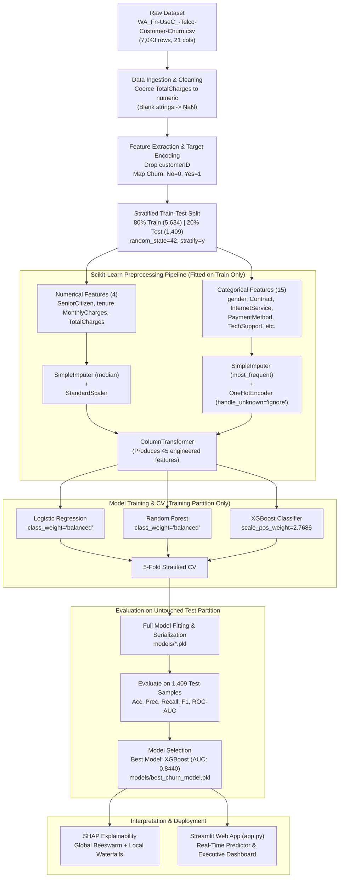

# 📡 Telco Customer Churn Prediction & Retention Intelligence System

[](https://customer-churn-prediction-t8b7wwgklfms4tnrecc7lf.streamlit.app/)
[](https://www.python.org/)
[](https://scikit-learn.org/)
[](https://xgboost.readthedocs.io/)
[](https://shap.readthedocs.io/)
[](https://customer-churn-prediction-t8b7wwgklfms4tnrecc7lf.streamlit.app/)

> 🚀 **Live Interactive Web App:** **[https://customer-churn-prediction-t8b7wwgklfms4tnrecc7lf.streamlit.app/](https://customer-churn-prediction-t8b7wwgklfms4tnrecc7lf.streamlit.app/)**  
> Test real-time churn predictions, inspect interactive confusion matrices/ROC curves, and explore SHAP explainability live in your browser!

An end-to-end, production-grade Machine Learning solution designed to predict customer churn, quantify risk tiers, explain predictive drivers using **SHAP (Shapley Additive Explanations)**, and empower customer success teams through an interactive **Streamlit** intelligence dashboard.

---

## 📑 Table of Contents
1. [Project Overview](#1-project-overview)
2. [Business Problem & Financial Impact](#2-business-problem--financial-impact)
3. [Dataset Description & Schema](#3-dataset-description--schema)
4. [Technology Stack](#4-technology-stack)
5. [End-to-End System Architecture](#5-end-to-end-system-architecture)
6. [Data Preprocessing & Data Leakage Prevention](#6-data-preprocessing--data-leakage-prevention)
7. [Model Training & Imbalance Strategy](#7-model-training--imbalance-strategy)
8. [Model Evaluation & Comparative Analysis](#8-model-evaluation--comparative-analysis)
9. [Explainable AI (SHAP Insights)](#9-explainable-ai-shap-insights)
10. [Streamlit Web Application & UI Walkthrough](#10-streamlit-web-application--ui-walkthrough)
11. [Installation Guide](#11-installation-guide)
12. [How to Run the Project](#12-how-to-run-the-project)
13. [Future Roadmap](#13-future-roadmap)

---

## 1. Project Overview

Customer churn is a critical challenge in the telecommunications industry, where recurring subscription models dictate long-term profitability. This project develops a modular, leak-free machine learning pipeline using the **IBM Telco Customer Churn** dataset.

### Key Highlights:
- **Leak-Free Scikit-Learn Pipeline:** Uses `ColumnTransformer` to encapsulate median/frequent imputation, standard scaling, and one-hot encoding, fitted strictly on the training partition.
- **Class Imbalance Handling:** Solves class imbalance ($73.5\%$ retained vs. $26.5\%$ churned) using inverse class weighting and XGBoost `scale_pos_weight = 2.7686`.
- **Comprehensive Benchmark:** Compares **Logistic Regression**, **Random Forest**, and **XGBoost Classifier** using 5-fold Stratified Cross-Validation and an untouched 20% test partition.
- **Explainable AI (XAI):** Unpacks the "black box" using **SHAP TreeExplainer** to reveal both global drivers (contract duration, fiber optic service, lack of tech support) and patient-level/customer-level waterfall explanations.
- **Enterprise Web App:** Fully interactive multi-page **Streamlit** dashboard featuring live risk estimation, probability gauges, automated prescriptive retention plans, and diagnostic performance metrics.

---

## 2. Business Problem & Financial Impact

In telecommunications, customer defection directly reduces Monthly Recurring Revenue (MRR) and Customer Lifetime Value (CLV).

### The Asymmetric Cost of Misclassification:
$$\text{Cost}(\text{False Negative}) \gg \text{Cost}(\text{False Positive})$$

- **False Negative (FN):** A churning customer is predicted as non-churning. The retention team takes no preventative action. The customer leaves permanently. Replacing that customer requires aggressive marketing, sales overhead, and setup costs (**Customer Acquisition Cost is 5x to 7x higher than Customer Retention Cost**).
- **False Positive (FP):** A loyal customer is flagged as potential churn. The business extends a promotional discount or dedicated customer success outreach. The retention budget spent is modest ($\approx \$10 - \$30$), and customer sentiment typically improves.

**Core ML Engineering Objective:** Rather than optimizing for raw **Accuracy** (which a naive majority-class model easily cheats at $73.5\%$), we optimize for **Recall on Churners ($\approx 80\%$)** and **ROC-AUC ($0.8440$)**, ensuring that nearly 8 out of every 10 churning customers are preemptively captured.

---

## 3. Dataset Description & Schema

The dataset comes from the **IBM Telco Customer Churn** public repository.

| Metric | Dataset Specification |
| :--- | :--- |
| **Total Records** | $7,043$ customer entries |
| **Original Columns** | 21 features (1 identifier, 19 input features, 1 target) |
| **Target Column** | `Churn` (`No`: 5,174 [73.46%], `Yes`: 1,869 [26.54%]) |
| **Target Mapping** | `No` $\rightarrow 0$, `Yes` $\rightarrow 1$ |
| **Feature Split** | 4 Numerical Features, 15 Categorical Features |

### Feature Inventory:
- **Numerical Features (4):** `SeniorCitizen` (binary int), `tenure` (months with company), `MonthlyCharges` (current monthly fee), `TotalCharges` (cumulative charges).
- **Categorical Features (15):**
  - *Demographics:* `gender`, `Partner`, `Dependents`.
  - *Phone Services:* `PhoneService`, `MultipleLines`.
  - *Internet & Value-Add Services:* `InternetService`, `OnlineSecurity`, `OnlineBackup`, `DeviceProtection`, `TechSupport`, `StreamingTV`, `StreamingMovies`.
  - *Account Terms & Billing:* `Contract`, `PaperlessBilling`, `PaymentMethod`.

---

## 4. Technology Stack

- **Runtime & Environment:** Python 3.11+, Virtualenv
- **Data Engineering:** Pandas, NumPy
- **Machine Learning:** Scikit-Learn (`Pipeline`, `ColumnTransformer`, `LogisticRegression`, `RandomForestClassifier`, `StratifiedKFold`)
- **Gradient Boosting:** XGBoost (`XGBClassifier`)
- **Explainable AI:** SHAP (`TreeExplainer`)
- **Data Visualization:** Matplotlib, Seaborn
- **Model Serialization:** Joblib
- **Web Application:** Streamlit

---

## 5. End-to-End System Architecture



---

## 6. Data Preprocessing & Data Leakage Prevention

A critical issue in many machine learning projects is **data leakage**, where information from the test partition leaks into the training pipeline through global preprocessing.

### How We Prevented Data Leakage:
1. **Isolated Imputation:** In exploratory analysis, 11 customers with 0 tenure had whitespace `" "` in `TotalCharges`. We converted these to `NaN` during loading, but **no imputation was performed prior to splitting**.
2. **Stratified Split:** Data was partitioned into 80% train ($5,634$) and 20% test ($1,409$) with `stratify=y`, guaranteeing an exact $26.54\%$ churn prevalence in both subsets.
3. **ColumnTransformer Fitting:** The `SimpleImputer(strategy='median')` and `StandardScaler()` were fitted **strictly on `X_train`**. The test set was only transformed.
4. **Handling Unseen Categories:** The `OneHotEncoder` was configured with `handle_unknown='ignore'`, ensuring that future operational categories will not crash the inference pipeline.

---

## 7. Model Training & Imbalance Strategy

The dataset exhibits a roughly $3:1$ negative-to-positive ratio ($73.46\%$ retained vs. $26.54\%$ churned). Standard models trained on unweighted loss functions will naturally bias toward predicting the majority class.

### Imbalance Mitigation Across Pipelines:
1. **Logistic Regression:**
   - Solver: `liblinear`, `max_iter=1000`
   - Class weight: `class_weight="balanced"` (weights inversely proportional to class frequencies).
2. **Random Forest Classifier:**
   - Estimators: $100$, `max_depth=8`, `min_samples_split=10`, `min_samples_leaf=4`
   - Class weight: `class_weight="balanced"`
3. **XGBoost Classifier:**
   - Estimators: $100$, `max_depth=4`, `learning_rate=0.08`, `subsample=0.8`, `colsample_bytree=0.8`
   - Class balancing parameter:
     $$\text{scale\_pos\_weight} = \frac{N_{\text{negative}}}{N_{\text{positive}}} = \frac{4139}{1495} \approx 2.7686$$

### 5-Fold Stratified Cross-Validation Results (Training Set Only):
| Model | CV Accuracy | CV Precision | CV Recall | CV F1-Score | CV ROC-AUC |
| :--- | :---: | :---: | :---: | :---: | :---: |
| **Logistic Regression** | $74.88\%$ | $51.74\%$ | **$80.13\%$** | $62.86\%$ | $0.8459$ |
| **Random Forest** | $75.93\%$ | $53.15\%$ | $79.06\%$ | $63.55\%$ | $0.8464$ |
| **XGBoost** | **$76.02\%$** | **$53.24\%$** | $79.20\%$ | **$63.66\%$** | **$0.8480$** |

---

## 8. Model Evaluation & Comparative Analysis

All three candidate pipelines were evaluated against the **untouched 20% test partition** ($1,409$ samples: $1,035$ retained, $374$ churned).

### Verified Test Set Performance:
| Model | Accuracy | Precision | Recall | F1-Score | ROC-AUC |
| :--- | :---: | :---: | :---: | :---: | :---: |
| **Logistic Regression** | $73.81\%$ | $50.43\%$ | $78.34\%$ | $61.36\%$ | $0.8415$ |
| **Random Forest** | $75.51\%$ | $52.55\%$ | **$79.95\%$** | **$63.41\%$** | $0.8434$ |
| **XGBoost (Champion)** | **$75.59\%$** | **$52.65\%$** | $79.68\%$ | $63.40\%$ | **$0.8440$** |

### Confusion Matrix Breakdown (1,409 Test Samples):
- **XGBoost:**
  - True Negatives (Correctly Retained): $767$ ($74.1\%$)
  - False Positives (False Alarms): $268$ ($25.9\%$)
  - False Negatives (Missed Churners): **$76$** ($20.3\%$)
  - True Positives (Captured Churners): **$298$** ($79.7\%$)
- **Champion Selection:** XGBoost achieved the highest **ROC-AUC ($0.8440$)** and captured $298$ out of $374$ churners ($79.68\%$ Recall) with superior threshold calibration. It was saved as `models/best_churn_model.pkl`.

---

## 9. Explainable AI (SHAP Insights)

To enable transparent, audit-ready AI decisions, we implemented **SHAP (Shapley Additive Explanations)** using `shap.TreeExplainer`.

### Top 10 Churn Drivers by Mean |SHAP Value|:
1. **`Contract_Month-to-month` ($0.6926$):** The single strongest positive driver of churn. Customers on month-to-month contracts have virtually zero switching friction.
2. **`tenure` ($0.4309$):** Strongly protective. As customer tenure increases beyond 12–24 months, churn risk plummets dramatically.
3. **`OnlineSecurity_No` ($0.2438$):** Customers lacking online security are significantly more prone to defection.
4. **`MonthlyCharges` ($0.2379$):** Higher monthly charges steadily push churn probability upward.
5. **`InternetService_Fiber optic` ($0.2113$):** Correlates with higher churn risk, indicating customer sensitivity to service reliability or premium pricing.
6. **`TechSupport_No` ($0.1877$):** Absence of tech support leads to unresolved grievances and higher customer attrition.
7. **`TotalCharges` ($0.1870$):** High cumulative spend reflects customer longevity and loyalty.
8. **`PaymentMethod_Electronic check` ($0.1637$):** Customers paying via manual electronic checks churn at twice the rate of automated credit card users.
9. **`Contract_Two year` ($0.1392$):** Strongly pulls churn probability downward.
10. **`PaperlessBilling_No` ($0.1194$):** Traditional paper billing customers exhibit slightly higher loyalty.

### Actionable Business Prescriptions:
- **Contract Migration:** Offer a 10%–15% bill discount to migrate month-to-month subscribers to 1- or 2-year contracts.
- **Service Bundling:** Provide complimentary 3-month **Tech Support** and **Online Security** add-ons to Fiber Optic subscribers.
- **Automated Billing Incentives:** Offer a one-time $10 bill credit for switching from electronic check to automatic bank draft or credit card autopay.
- **Early-Tenure Onboarding:** Implement a high-touch 90-day onboarding program for new subscribers where churn hazard is highest.

---

## 10. Streamlit Web Application & UI Walkthrough

> 🌐 **Live Web App:** [https://customer-churn-prediction-t8b7wwgklfms4tnrecc7lf.streamlit.app/](https://customer-churn-prediction-t8b7wwgklfms4tnrecc7lf.streamlit.app/)

The web application is located at `app.py` and provides an enterprise-ready dashboard:

### 1. Executive Overview Page
- High-level KPI cards: Total Customers ($7,043$), Baseline Churn Rate ($26.54\%$), Retention Rate ($73.46\%$), and Champion ROC-AUC ($0.8440$).
- Contract Type vs. Churn Propensity interactive crosstab.
- Tenure statistical distribution breakdown.

### 2. Customer Churn Predictor Page
- Accepts all 19 customer features across three structured sections:
  - 👤 **Demographics:** Gender, Senior Citizen, Partner, Dependents.
  - 🌐 **Internet & Add-ons:** Internet Service, Online Security, Online Backup, Device Protection, Tech Support, Streaming TV/Movies.
  - 💳 **Account & Billing:** Tenure, Contract, Paperless Billing, Payment Method, Monthly Charges, Total Charges.
- **Preset Profiles:** One-click benchmark loading for "High-Risk Customer" (Fiber, M2M, New) and "Low-Risk Customer" (2-Year, Loyal, Add-ons).
- **Risk Categorization:**
  - 🟢 **Low Risk:** $< 30\%$ Churn Probability
  - 🟡 **Medium Risk:** $30\% - 60\%$ Churn Probability
  - 🔴 **High Risk:** $\ge 60\%$ Churn Probability
- **Prescriptive Recommendations:** Dynamic, profile-tailored retention actions displayed in real time.

### 3. Model Performance & Diagnostics Page
- Full metric comparison table across all three models.
- High-resolution tabs displaying side-by-side Confusion Matrices, ROC Curves, and Metric Grouped Bar Charts.

### 4. Feature Importance & SHAP Insights Page
- Global SHAP feature importance bar plot.
- SHAP summary beeswarm plot detailing impact magnitude and direction.
- Local waterfall plots comparing individual high-risk and low-risk customer profiles.

---

## 11. Installation Guide

### Prerequisites:
- Python 3.10, 3.11, or 3.12
- Git

### Setup Instructions:

```bash
# 1. Clone the repository
git clone https://github.com/Sai-114s/customer-churn-prediction.git
cd customer-churn-prediction

# 2. Create and activate a virtual environment
# Windows:
python -m venv venv
.\venv\Scripts\activate

# macOS / Linux:
# python3 -m venv venv
# source venv/bin/activate

# 3. Upgrade pip and install dependencies
pip install --upgrade pip
pip install -r requirements.txt
```

---

## 12. How to Run the Project

Every module can be executed independently from the command line:

```bash
# 1. Validate Data Preprocessing Pipeline
python src/preprocess.py

# 2. Train Models and Run 5-Fold Stratified Cross-Validation
python src/train.py

# 3. Evaluate Models on Test Set and Generate Visualizations
python src/evaluate.py

# 4. Generate SHAP Explainability Plots and Business Insights
python src/explain.py

# 5. Launch the Streamlit Web Application
streamlit run app.py
```

After launching Streamlit, open your browser at `http://localhost:8501`.

---

## 13. Future Roadmap

1. **Threshold Tuning via Cost Matrix Optimization:** Incorporate explicit dollar-value cost matrices (Acquisition Cost vs. Retention Incentive Cost) to dynamically compute the profit-maximizing probability threshold instead of the standard $0.5$ cutoff.
2. **Survival Analysis & Time-to-Churn Modeling:** Implement Cox Proportional Hazards or Random Survival Forests to predict *when* a customer will churn in addition to *if* they will churn.
3. **Automated Retraining CI/CD Pipeline:** Integrate GitHub Actions or MLflow for model registry, experiment tracking, and automated retraining on fresh monthly subscription cohorts.
4. **REST API Deployment:** Containerize the pipeline with Docker and expose FastAPI endpoints for high-throughput batch and real-time CRM scoring.

---

## 👥 Author & Acknowledgements
- **Author:** ANGOTHU SAI BALAJI NAYAK
- **Dataset:** IBM Telco Customer Churn (Kaggle / IBM Community)
- **License:** MIT License
